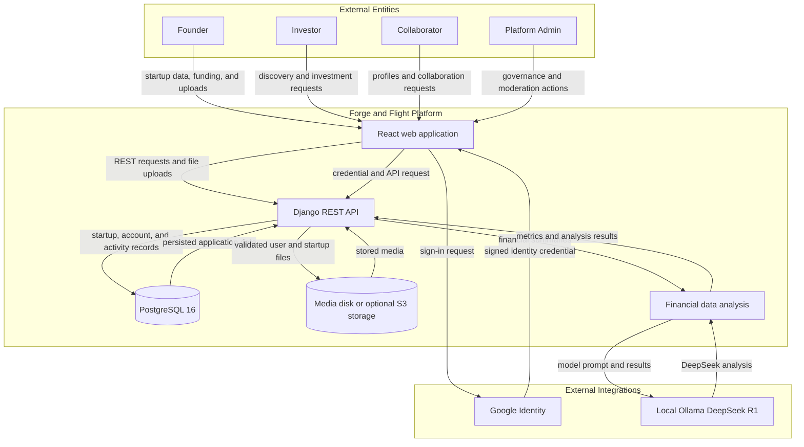
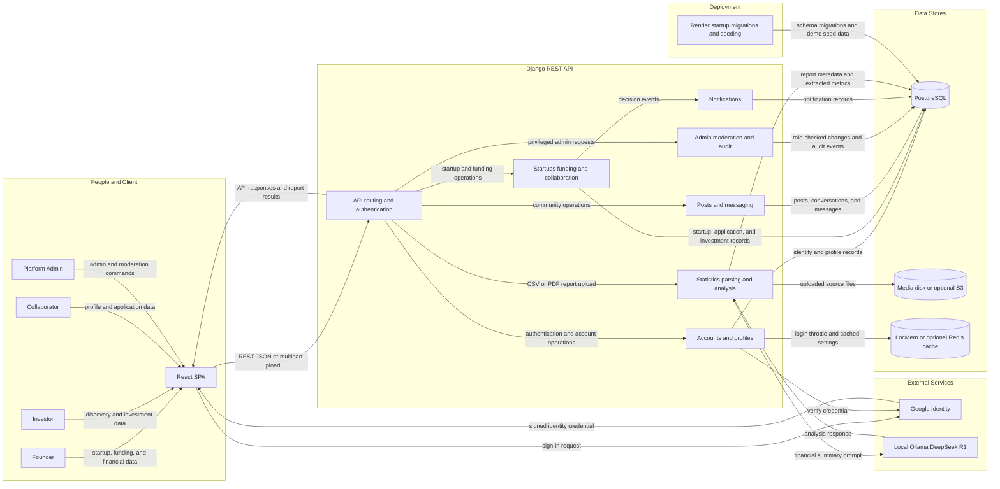

# Architecture Diagram

This document shows how Forge & Flight moves data between its users, React client, Django API, persistent stores, and integrations. The first view summarizes the system boundary; the second expands the principal API workflows and data stores.

## Application Architecture

<!-- mermaid-checked: no \n, no em-dash/en-dash, no {} in labels, subgraphs are id["label"], arrows are -->|"label"|, all subgraphs closed by end, ids unique -->

### Technology Stack Summary

| Layer | Technology | Version | Purpose |
|---|---|---|---|
| Client | React | 19.3.1 | Role-based startup, investor, collaborator, and admin user interfaces |
| Client build | Vite | 8.1.1 | Development server and production SPA build |
| API | Django | 6.0.7 | HTTP endpoints, authentication, permissions, and domain workflows |
| API | Django REST Framework | 3.17.1 | Token-authenticated REST API and serialization |
| Primary data store | PostgreSQL | 16 | Accounts, startups, funding, posts, messages, reports, and audit records |
| AI integration | Ollama with DeepSeek R1 | `deepseek-r1:1.5b` default | Local financial analysis of parsed founder uploads |
| Deployment | Vercel and Render | Managed services | Hosts the SPA and Django API; Render configuration provisions PostgreSQL |
| File storage | Django file storage | Local disk by default; optional S3-compatible storage | Stores validated avatars, resumes, startup documents, media, and analytics uploads |

### Data Storage & External Services

PostgreSQL is the source of truth for users, startups, applications, investments, community content, conversations, notifications, analytics reports, and audit events. Uploaded files are validated and stored using Django's configured file storage, which defaults to disk; S3-compatible storage is available when configured. The analytics workflow parses CSV or PDF uploads, stores extracted metrics, and sends a financial summary to Ollama for analysis. Google Identity is an optional sign-in integration; the API verifies the returned identity credential before associating it with a local account. Login throttling and site settings use Django's configured cache, which is process-local by default and can use Redis when configured. On Render, startup applies database migrations and seeds the Bangladeshi demo ecosystem and super-admin before launching the API.

### Key Architectural Decisions

- The React SPA is decoupled from the Django REST API and exchanges JSON or multipart file uploads over HTTP.
- Funding and application state changes are centralized in transactional services; sensitive actions are recorded in the audit log.
- Financial uploads are parsed server-side, with local Ollama inference and a built-in analysis fallback when the model service is unavailable.

## Component Relationships

<!-- mermaid-checked: no \n, no em-dash/en-dash, no {} in labels, subgraphs are id["label"], arrows are -->|"label"|, all subgraphs closed by end, ids unique -->

### Component Inventory

| Component | Layer | Type | Responsibility |
|---|---|---|---|
| React SPA | Client | Web application | Presents platform workflows and sends API requests |
| API routing and authentication | API | REST entry point | Routes requests and enforces authentication and permissions |
| Accounts and profiles | API | Domain module | Manages local users, profile data, and Google-linked identities |
| Startups funding and collaboration | API | Domain module | Manages startup listings, investment decisions, funding, and applications |
| Posts and messaging | API | Domain module | Manages community posts, conversations, and messages |
| Admin moderation and audit | API | Admin and cross-cutting modules | Enforces admin capabilities, moderation, and sensitive-action logging |
| Notifications | API | Domain module | Persists notifications created by platform workflows |
| Statistics parsing and analysis | API | Analytics module | Validates and parses CSV/PDF reports, computes metrics, and requests AI analysis |
| Render startup migrations and seeding | Deployment | Startup process | Applies database migrations and seeds demo data and the super-admin before serving requests |
| PostgreSQL | Data | Relational database | Stores platform records and analytics results |
| Media storage | Data | File storage | Stores uploads and serves their media references |
| LocMem or Redis cache | Data | Cache | Supports login throttling and cached settings |
| Google Identity | External | Identity provider | Supplies credentials for optional Google sign-in |
| Ollama DeepSeek R1 | External | Local AI service | Generates analysis from the submitted financial summary |
